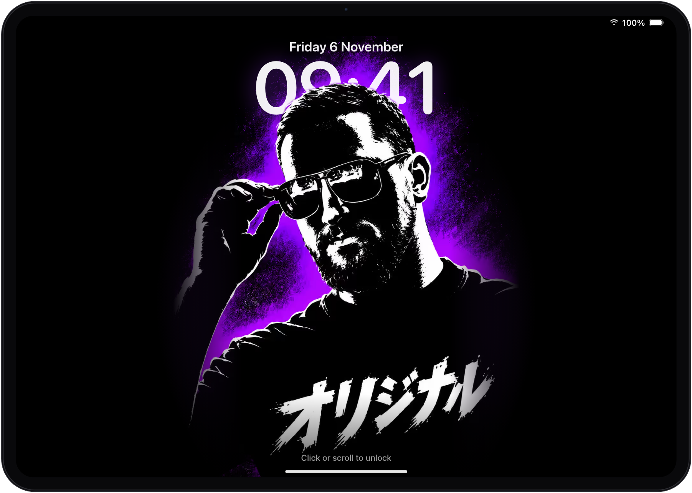

  

## Hi, I'm Artem 👋

Freelance iOS developer. I design, build and ship native iPhone apps in SwiftUI, from the first prototype to App Store release, subscriptions and growth.

Every app below is my own: designed, built, launched and maintained solo.

🌐 [aleksandrov.cv](https://aleksandrov.cv) · 💼 [LinkedIn](https://www.linkedin.com/in/artem-aleksandrov-ios/) · 🧵 [Threads](https://www.threads.com/@artem.aleksandrovv) · 📍 Remote, CET · 🗣 English, Russian, Ukrainian

---

### 📱 Live on the App Store

<table>
  <tr>
    <td width="50%" align="center" valign="top">
      <h3> Fridgea Fridge &amp; Grocery List</h3>
      
Know what's in your fridge. Expiry reminders, a shopping list shared with the family and AI recipes from what you already have.

      <code>SwiftUI</code> <code>Core&nbsp;Data&nbsp;+&nbsp;CloudKit</code> <code>WidgetKit</code> <code>RevenueCat</code> <code>Vertex&nbsp;AI</code>
      
<a href="https://apps.apple.com/app/apple-store/id6756065960?pt=57180800&ct=github&mt=8">App Store</a> · <a href="https://fridgea.online">Website</a>

    </td>
    <td width="50%" align="center" valign="top">
      <h3> Fogged Travel Photo Map</h3>
      
Your photos clear the fog off a world map, one place at a time. Trips build themselves. No account, no server: photos never leave the iPhone.

      <code>SwiftUI</code> <code>SwiftData</code> <code>PhotoKit</code> <code>MapKit</code>
      
<a href="https://apps.apple.com/app/apple-store/id6799502565?pt=57180800&ct=github&mt=8">App Store</a> · <a href="https://fogged.app">Website</a>

    </td>
  </tr>
  <tr>
    <td width="50%" align="center" valign="top">
      <h3> PilotTestZone PPL Exam Prep</h3>
      
Prep for the Polish ULC PPL(A) theory exam: the full question bank, weak-topic analytics and official exam dates.

      <code>SwiftUI</code> <code>Core&nbsp;Data</code> <code>Swift&nbsp;Charts</code> <code>Live&nbsp;Activities</code> <code>RevenueCat</code>
      
<a href="https://apps.apple.com/app/apple-store/id6741020820?pt=57180800&ct=github&mt=8">App Store</a> · <a href="https://pilottestzone.com">Website</a>

    </td>
    <td width="50%" align="center" valign="top">
      <h3> Lights Out Mafia Table Game</h3>
      
The classic Mafia party game with one phone as the narrator, so nobody has to sit out as the host. Works offline.

      <code>SwiftUI</code> <code>SwiftData</code> <code>AVFoundation</code>
      
<a href="https://apps.apple.com/app/apple-store/id6785313453?pt=57180800&ct=github&mt=8">App Store</a> · <a href="https://artem-alexandrov.github.io/mafia_landing/">Website</a>

    </td>
  </tr>
</table>

### 🌐 On the web

<table>
  <tr>
    <td align="center" valign="top">
      <h3> Growly Threads scheduler for creators</h3>
      
Post on Threads every day without living in the app: recurring posting slots, a draft pool and per-post analytics.

      <code>Next.js</code> <code>Supabase</code> <code>Redis&nbsp;+&nbsp;BullMQ</code> <code>Threads&nbsp;API</code>
      
<a href="https://growly.social">Website</a>

    </td>
  </tr>
</table>

---

### 🤝 Work with me

- An iOS app MVP, taken all the way to the App Store
- Subscriptions, paywalls and onboarding (RevenueCat, StoreKit)
- Core Data or SwiftData sync over CloudKit, including data shared with family
- ASO, App Store Connect and release automation
- A landing page or a small backend next to the app (Next.js, Astro, Supabase)

Get in touch through [aleksandrov.cv](https://aleksandrov.cv).

### 🛠 Stack

 

**Product:** paywalls, onboarding, subscription pricing, ASO, App Store strategy.

### 💬 Ask me about

- Core Data ⇄ CloudKit shared zones (and how not to lose data)
- SwiftUI performance and state design
- Monetization with ads and subscriptions on iOS
- Shipping indie apps solo

---

⚡ **Fun fact:** the iPad at the top isn't a mockup, it's my portfolio. When Apple reviews one of my apps, a Live Activity shows up on its lock screen and follows the review until the update is live.
